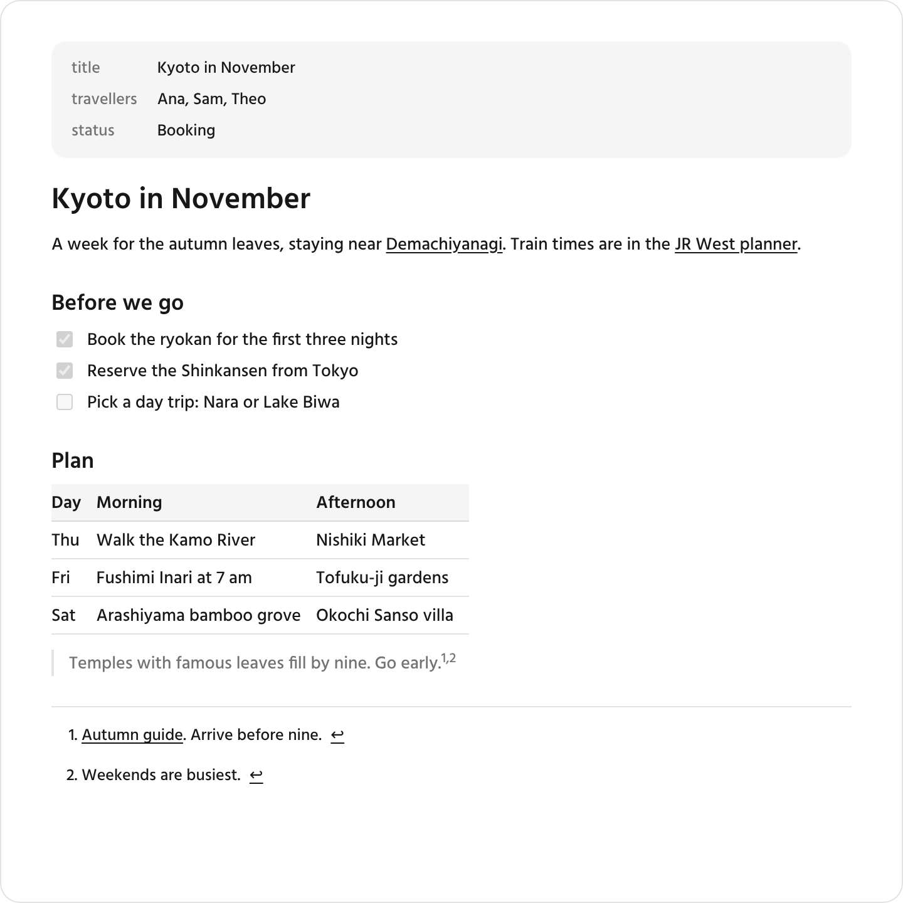

# tv-markdown

Renders a Markdown document in an HTML artifact. It supports GitHub-flavoured Markdown, including tables, task lists and footnotes, and gives each heading an id that can be linked to. Frontmatter can be shown as a properties panel. `[[wikilinks]]` become links, and the page decides where they lead. Scripts, styles and other HTML outside an allowed list are removed.

<picture>
  <source media="(prefers-color-scheme: dark)" srcset="../../docs/screenshots/tv-markdown-dark.png">
  
</picture>

## Install

```sh
npx skills add rupertsworld/made-for-tv --skill tv-markdown
```

Add `-g` to install it for every project instead of the current one. To install without the [skills CLI](https://github.com/vercel-labs/skills), copy the contents of [`dist/`](dist/) into a folder named `tv-markdown` in the skills folder of your agent, such as `~/.claude/skills/tv-markdown/` for Claude Code.

[`SKILL.md`](dist/SKILL.md) tells the agent when and how to use the skill. It is built from [`src/index.md`](src/index.md).

## Footnotes

Use `[^label]` for a citation and define it on its own line. Labels are case-insensitive. Repeated citations share one numbered footnote, which links back to every citation. Adjacent citations display with a comma between their numbers.

```markdown
A short claim.[^source] The same source applies here.[^source]

[^source]: [Source](https://example.org/source). Supports both claims.
```

A definition may follow a paragraph without a blank line and may have up to three leading spaces. Plain continuation lines remain in its first paragraph. Indent content by four spaces after a blank line to add another paragraph, list or other block.

Links in the document and its footnotes keep custom schemes such as `autofile:`. The sanitizer removes only `javascript:`, `vbscript:` and `data:` addresses.
